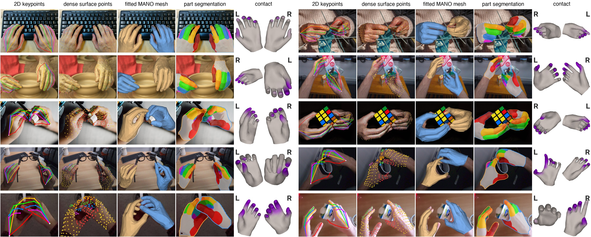

# FAH: Fast and Accurate Hand Estimation

[Paper (PDF)](https://arxiv.org/pdf/2611.07711) | [Project page][page]



FAH predicts 2D and 3D hand joints and surface points, then fits MANO, MHR-Hand or both.
Optional heads add part labels and object-contact probabilities. Video mode refines tracks;
world mode adds camera estimation.

FAH-L reaches **4.31 mm HOT3D PA-MPJPE at 65 fps** with mesh fitting on an RTX 4070 Ti SUPER.
FAH-S runs at 101 fps with fitting, or 125 fps without fitting, parts or contact.
See the [project page][page] for results, videos and image credits.

## Install

Python 3.10+ and PyTorch 2.1+ are required. From a clone:

```bash
git clone https://github.com/noahcao/FAH.git
cd FAH
python3.11 -m venv .venv
source .venv/bin/activate
pip install torch torchvision --index-url https://download.pytorch.org/whl/cu128
pip install -e ".[trt]"
```

On CPU or Apple silicon, omit the CUDA PyTorch command and install with `pip install -e .`.
For uv, use `uv venv --python 3.11` and `uv pip install` instead.
Inference does not require Ultralytics.

Required files (default root: `~/.cache/fah`, overridden by `$FAH_HOME`):

1. **FAH weights:** download them to `~/.cache/fah/weights`, or set `$FAH_WEIGHTS` / `--weights DIR`.
   ```bash
   hf download noahcao/FAH --exclude "qc/*" --local-dir ~/.cache/fah/weights
   ```
   ```text
   weights/{fah-s,fah-b,fah,fah-h}/{model.pt,config.json,contact.pt,contact_video.pt}
   weights/shared/{detector.pt,mesh_fitter.pt,video_refiner.pt,camera_motion.pt,mhr_fitter.pt}
   ```
   Verify the inference-only download on Linux with:
   ```bash
   (cd ~/.cache/fah/weights && grep -v 'qc/' SHA256SUMS | sha256sum -c -)
   ```
   On macOS, use `shasum -a 256 -c -`. Download without `--exclude "qc/*"` before checking the full
   manifest with `sha256sum -c SHA256SUMS`.

2. **SAM 3D Body config and MHR model:** accept the [SAM licence on Hugging Face](https://huggingface.co/facebook/sam-3d-body-dinov3),
   run `hf auth login`, then:
   ```bash
   python -c "import fah; fah.download_sam3d()"
   ```
   These go to `~/.cache/fah/sam-3d-body-dinov3` (`$FAH_SAM3D` / `--sam3d DIR` to override).
   FAH does not need the SAM 3D Body network checkpoint for inference.
3. **MANO:** register and download from [mano.is.tue.mpg.de](https://mano.is.tue.mpg.de), then convert:
   ```bash
   python bench/convert_mano.py mano_v1_2/models ~/.cache/fah/mano
   ```
   Set `$MANO_DIR` / `--mano_dir` for another location.

Optional extras: `trt` (TensorRT runtime), `engine` (engine builds), `coreml` (Apple silicon),
`world` (MoGe-2), `offline` (offline camera dependencies), `train`, `eval`, and `contact` (contact label builders).
World mode also needs [separate camera environments](docs/world.md#requirements).

## Quick start

```bash
cp configs/local.example.json configs/local.json  # edit paths and options once
python scripts/infer.py hand.jpg
python scripts/infer.py clip.mp4
```

Optional outputs, backend and model are selected in `configs/local.json`.
For training, use `python scripts/train.py <stage>`; see [Training](docs/training.md).

```python
import cv2
import fah

model = fah.load("fah", mode="image")
hands = model(cv2.imread("hand.jpg"), K=None)
for hand in hands:
    joints = hand["joints3d"]  # (21, 3), camera frame, metres
```

For video, call `model.reset()` before each clip and process frames in order.
Coordinates are x right, y down, z forward; 2D coordinates are pixels.
Use `fah --help` for options or the [usage and output reference](docs/usage.md) for API keys,
contact thresholds, video rendering and identity tracking.

## Model zoo

| model | `--backbone` (model name) | encoder | crop | HOT3D PA-MPJPE (mm) | fps (RTX 4070 Ti SUPER, TensorRT) |
|---|---|---|---|---|---|
| FAH-S | `s` (`fah-s`) | DINOv3 ViT-S/16 | 320 | 5.25 | 101 |
| FAH-B | `b` (`fah-b`) | DINOv3 ViT-B/16 | 320 | 4.57 | 89 |
| **FAH-L** | `l` (`fah`) | DINOv3 ViT-L/16 | 320 | 4.31 | 65 |
| FAH-H | `h` (`fah-h`) | DINOv3 ViT-H+/16 | 448 | 4.12 | 27 |

FAH-L (`fah`) is the default. The table uses mesh fitting and TensorRT on HOT3D;
parts and contact are off. FPS is the slower of two median-time runs on an RTX 4070 Ti SUPER under WSL2.
FAH-L runs at 54 fps with parts, 49 fps with parts and contact, and 59 fps in video mode.
World mode runs at 29 fps with the causal camera or 7.1 fps offline on four EgoStandard clips;
model loading and decoding are excluded, and causal timing uses runs without host swapping. The causal 29 fps
configuration predicts joints and dense points without mesh fitting, parts or contact; the offline 7.1 fps configuration includes MANO fitting.

FAH uses the SAM 3-mask detector (`shared/detector.pt`).
Tiny hands in collages and tightly crossed hands remain difficult.

## Documentation

| Task | Guide |
|---|---|
| API, outputs, contact and video options | [Usage](docs/usage.md) |
| TensorRT, Core ML and live camera | [Acceleration](docs/acceleration.md) |
| Camera setup and world-space evaluation | [World space](docs/world.md) |
| MANO and MHR-Hand fits | [Parametric hands](docs/mhr_hand.md) |
| Training stages and data mix | [Training](docs/training.md) |
| Contact training and data | [Contact](docs/contact.md), [data](docs/contact_data.md) |
| Benchmarks and timing | [Evaluation](docs/evaluation.md) |
| Release evaluation and figures | [Reproduction](docs/reproduce.md) |
| Evaluation annotations and image builders | [Datasets](datasets/README.md) |
| Real-to-sim study | [Real to sim](docs/real2sim.md) |

## Citation

```bibtex
@misc{cao2026fastaccuratehandestimation,
  title         = {Fast and Accurate Hand Estimation in Pixels, Interaction and World Space},
  author        = {Jinkun Cao},
  year          = {2026},
  eprint        = {2611.07711},
  archivePrefix = {arXiv},
  primaryClass  = {cs.CV},
  url           = {https://arxiv.org/abs/2611.07711}
}
```

## Licence and notice

- **Code:** [Apache 2.0](LICENSE), except upstream files identified in [NOTICE](NOTICE) and
  [THIRD_PARTY_NOTICES.md](THIRD_PARTY_NOTICES.md).
- **All FAH weights, including the detector, fitted data and exported models:** [WEIGHTS_LICENSE](WEIGHTS_LICENSE),
  for research and non-commercial use. SAM, DINOv3 and detector upstream terms apply to the relevant components;
  the shared licence documents their scope and attribution requirements.
- **External assets:** MANO and downloaded upstream models retain their own licences.
  Dataset images are not redistributed; evaluation labels use [datasets/LICENSE.md](datasets/LICENSE.md).

[page]: https://noahcao.github.io/FAH/
[page-videos]: https://noahcao.github.io/FAH/#test-videos
